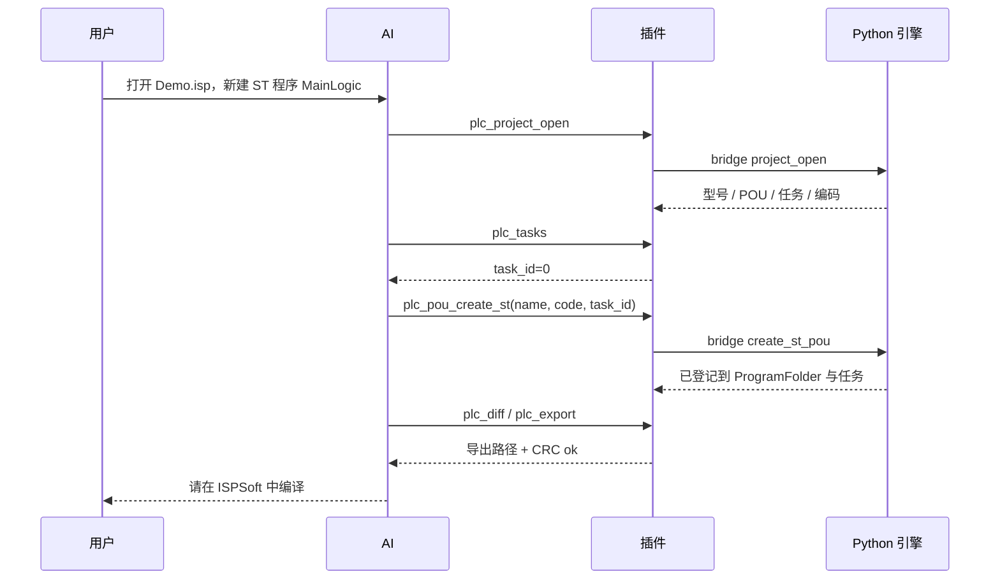

# dsh-delta-isp

> 在 DeepSeek Harness 里用自然语言读写台达 **ISPSoft** PLC 工程：查询 POU/符号、新建 ST 程序、生成梯形图自锁、导出并校验 `.isp`。

[](LICENSE)
[](https://github.com/deepseek-ai/deepseek-harness)
[](package.json)
[](python/pyproject.toml)
[](#兼容性)

一个 **DSH Host 插件 + 内置 Python 引擎**。插件把 16 个 PLC 工具注册给模型，Python 引擎负责
`.isp` 容器读写、工程模型、ST 校验和梯形图模板。

**原工程永远只读，所有改动都在工作区副本里完成；不联网、不上传任何工程数据。**

---

## 目录

- [这是什么](#这是什么)
- [为什么不是让 AI 点界面](#为什么不是让-ai-点界面)
- [功能](#功能)
- [架构](#架构)
- [项目结构](#项目结构)
- [安装](#安装)
- [配置](#配置)
- [验证安装](#验证安装)
- [5 分钟上手（新建工程）](#5-分钟上手新建工程)
- [使用示例](#使用示例)
- [工具清单](#工具清单)
- [工作原理](#工作原理)
- [隐私与安全](#隐私与安全)
- [兼容性](#兼容性)
- [已知限制](#已知限制)
- [故障排查](#故障排查)
- [开发与测试](#开发与测试)
- [路线图](#路线图)
- [贡献](#贡献)
- [许可](#许可)
- [FAQ](#faq)

---

## 这是什么

台达 ISPSoft 没有公开的命令行、COM 或脚本接口。AI 想"直接操作软件"只能模拟点击，慢且容易出错。

但 `.isp` 的本质是：**可变长头部 + 压缩的文本工程**。解压后是一个类 XML 的 `<PROJECT>` 文本，
POU 代码、局部变量、任务顺序、全局符号、DUT 全在里面。因此正确的路径不是点界面，而是：

> 插件读写工程文本 → AI 产出 ST / 梯形图模板 → ISPSoft 编译当裁判 → 人工确认后下载。

`dsh-delta-isp` 把这套能力封装成一个 DSH 插件：

- **安装插件** = 获得 16 个 `plc_*` 工具
- **新建并保存一个 `.isp`** = 得到型号/硬件配置正确的工程骨架
- **对 AI 说人话** = 它自己完成打开、查任务、建 POU、写代码、diff、导出
- **人工编译/下载** = 保持人在回路，符合工业安全习惯

## 为什么不是让 AI 点界面

| 方案 | 问题 |
|---|---|
| 截图 + 鼠标点击 | 慢、脆、无法 diff、每次 ISPSoft 改版都可能失效 |
| 直接改二进制 | 无法校验、容易写出"文件损坏" |
| 只做代码生成器 | 拿不到工程上下文（符号、任务、现有 POU），也无法闭环 |
| **本文方案：文本层读写 + 编译裁判** | 可 diff、可回滚、可版本管理，不依赖 UI 结构 |

实测结论（ISPSoft 3.19 / AS320T）：

- 解压后的文本包含 24 个 POU、4 个任务、GBK 编码、CRC32 与长度字段；
- 重打包后的工程能被 ISPSoft 正常打开；
- ISPSoft 的 POU 区**先 PRG 后 FB**，新 PRG 插错位置会在保存时被丢弃（插件已处理）。

## 功能

- **工程读取**：POU 列表、ST 代码、梯形图网络、局部变量、全局符号、DUT、任务顺序
- **ST 写入**：改写已有 ST POU，带 GBK 编码检查与静态检查
- **新建 ST 程序**：在空工程或现有工程中创建任意 ST POU，自动登记程序树并挂任务
- **新建梯形图自锁**：内置启动/停止/自锁模板，生成 `P_Lang=1` 的 POU
- **任务感知**：先列任务（`T_ID`），再决定新程序挂在哪
- **差异与回滚**：unified diff、按 POU 汇总、一键回滚
- **导出校验**：重新打包 `.isp`，校验 CRC32、源码长度、压缩段长度与文件长度
- **安全隔离**：原文件只读、工作区副本、写前二次解析、不自动下载 PLC
- **零 npm 依赖**：插件只用 Node 内置模块；Python 引擎只用标准库

## 架构


一次"新建程序"的调用顺序：



## 项目结构

```text
dsh-delta-isp/
├─ index.js                  Host 插件：Python 发现、bridge 调用、16 个工具、系统提示词
├─ package.json              DSH bundle 清单（dsh.bundle.patch）
├─ cordis.patch.yml          把插件插入当前 profile
├─ locale/{zh,en}.json       插件管理器显示名/描述
├─ icon.svg                  插件图标
├─ python/
│  ├─ pyproject.toml         独立 Python 包（可选 MCP server）
│  ├─ src/delta_isp_mcp/
│  │  ├─ isp/container.py    .isp ⇄ 文本（定位 / CRC / 长度 / 重打包）
│  │  ├─ isp/project.py      伪 XML ⇄ POU/TASK；ST 改写；新建 POU
│  │  ├─ isp/ladder.py       梯形图模板（自锁）
│  │  ├─ isp/symbols.py      全局符号 / DUT
│  │  ├─ lint/st_check.py    ST 预检
│  │  └─ service.py          工作区 / diff / 导出 / 回滚
│  └─ tests/                 20 个引擎测试
├─ test/harness.mjs          不依赖 DSH 的端到端测试（mock ctx + 真 bridge）
├─ docs/                     架构、安装、教程、工具、格式、发布
├─ examples/prompts.md       可直接复制的提示词
├─ README.md / README.en.md  中文 / 英文说明
├─ CONTRIBUTING.md / SECURITY.md / CHANGELOG.md
├─ LICENSE (MIT)
└─ .github/workflows/ci.yml  Node 语法 + Python 测试 + harness
```

## 安装

### 前置

| 依赖 | 要求 | 说明 |
|---|---|---|
| DeepSeek Harness | `>= 0.2.0-rc.1 < 0.3.0` | 插件通过 `ctx.tools` 注册 |
| Node.js | `>= 20` | DSH 自带即可，插件不装 npm 依赖 |
| Python | `>= 3.10` | 自动查找，见下 |
| 台达 ISPSoft | 3.19（推荐） | 只在打开/编译/下载时需要 |

**Python 自动发现顺序**：

1. 配置里的 `python`
2. `DELTA_ISP_PYTHON` 环境变量
3. Windows：`py -3.13` / `-3.12` / `-3.11` / `-3.10`
4. `python3` / `python`
5. DSH 自带运行时 `~/.dsh/dsh-runtimes/*/dependencies/python`
6. `%LOCALAPPDATA%\Programs\Python\Python3*`

每个候选都会实际执行并检查版本，低于 3.10 或输出异常的（例如某些厂商的 `python.bat`）会被跳过。

### 方式 A：从本地目录安装（推荐）

```powershell
git clone https://github.com/salute666666/-PLC-.git C:\tools\dsh-delta-isp
```

然后在 DSH 里安装这个目录。可以直接对 AI 说：

> 安装本地插件：`C:\tools\dsh-delta-isp`

底层执行 `plugin_manager` 的 `install_bundle`（绝对目录作为 `target`）。
也可以在 Settings → Plugins / Plugin Manager 里选择本地目录。

### 方式 B：从 GitHub 安装

仓库根目录就是插件包，克隆下来后按方式 A 安装即可。

### 方式 C：tgz 分发放

```powershell
npm pack
# dsh-delta-isp-0.2.1.tgz
```

把 tgz 发给别人，安装该包即可。

> **安装后请新开一个对话。** 工具列表在会话组装时生成；旧对话可能看不到新工具。

## 配置

可选文件：`~/.dsh-delta-isp/config.json`

```json
{
  "python": "",
  "workspace": "C:\\Users\\<you>\\.dsh-delta-isp\\plc-work",
  "allowRead": [
    "D:\\work"
  ]
}
```

| 字段 | 默认 | 说明 |
|---|---|---|
| `python` | 自动发现 | Python 3.10+ 绝对路径 |
| `workspace` | `~/.dsh-delta-isp/plc-work` | 工作区根目录（副本、导出、审计） |
| `allowRead` | `[]` | 允许打开的工程目录；空数组表示不限制 |

同样的字段也可以写在 `cordis.patch.yml` 的插件行 `config` 里，优先级高于 JSON 文件。

## 验证安装

新会话里对 AI 说：

> 用 plc_environment 检查 PLC 插件环境

期望返回：

```json
{
  "version": "0.2.1",
  "workspace": "C:\\Users\\<you>\\.dsh-delta-isp\\plc-work",
  "ispsoft_exe": "C:\\Program Files (x86)\\Delta Industrial Automation\\ISPSoft 3.19\\NewISPSoft.exe",
  "ispsoft_running": false,
  "plugin": {
    "python": { "command": "...python.exe", "args": [] },
    "node": "v20.x",
    "packageDir": "C:\\tools\\dsh-delta-isp"
  }
}
```

看不到 `plc_*` 工具时，先看 [故障排查](#故障排查)。

## 5 分钟上手（新建工程）

### 1. 在 ISPSoft 新建并保存工程

**文件 → 新建**，选择 PLC 型号（例如 `AS320T`），保存为 `D:\work\Demo.isp`。

> 这一步必须在 ISPSoft 里做：型号、硬件配置、`.hwc/.ex/.dlhw` 等侧车文件由厂商工具生成。
> 插件不会伪造工程骨架，否则型号/硬件很容易不匹配。

### 2. 对 AI 说

```text
打开 D:\work\Demo.isp，列出任务。
新建一个 ST 程序 MainLogic，挂到任务 0，代码：
M10 := M0 AND NOT M1;
IF M10 THEN
    M11 := TRUE;
ELSE
    M11 := FALSE;
END_IF;
然后导出。
```

AI 会自动执行：

```text
plc_project_open → plc_tasks → plc_pou_create_st → plc_lint → plc_diff → plc_export
```

空工程只有一个梯形图 `Prog0`；新 `MainLogic` 会插在它后面、登记到程序树、挂到任务 0，
**不会**被 ISPSoft 丢弃（PRG 必须排在 FB 前）。

### 3. 打开导出的工程并编译

导出路径会返回在 `plc_export` 结果里，通常在：

```text
~/.dsh-delta-isp/plc-work/projects/Demo-xxxxxxxx/exports/Demo-modified.isp
```

用 ISPSoft 打开它，按**编译**。编译 0 错误后，再人工下载。
不满意就 `plc_rollback`，原工程从未被修改。

## 使用示例

### 读懂一个工程

> 打开 `D:\work\Demo.isp`，列出所有 ST 程序，告诉我 `Maintenance` 在哪个任务、用了哪些变量。

工具：`plc_project_open` → `plc_pou_list` → `plc_pou_read` → `plc_symbols`。

### 改一段已有 ST

> 把 `Maintenance` 改成：计数器到 100 清零；先自检，再给我 diff。

工具：`plc_pou_read` → `plc_pou_write` → `plc_lint` → `plc_diff`。
diff 应该只包含目标 POU。

### 新建一个梯形图自锁

> 新建梯形图子程序 `自锁`：M0 启动、M1 停止、Y0.1 电机输出、M2 运行指示，挂到任务 0，然后导出。

工具：`plc_create_selflock` → `plc_export`。生成：

```text
        M0              M1
|-------[ ]------+-----[/]-----+-----( Y0.1 )
|                |             |
|      Y0.1      |             +-----( M2 )
|-------[ ]------+
```

### 导出、打开、回滚

> 导出并用 ISPSoft 打开。

工具：`plc_export` → `plc_open_in_ispsoft`。

> 回滚所有改动。

工具：`plc_rollback`，返回 `dirty=false`。

## 工具清单

| 工具 | 作用 | 主要参数 |
|---|---|---|
| `plc_environment` | 检查 Python / ISPSoft / 工作区 | — |
| `plc_project_open` | 打开工程（复制到工作区） | `path` |
| `plc_project_status` | 型号、版本、计数、dirty | — |
| `plc_pou_list` | POU 清单 | — |
| `plc_pou_read` | 读 POU | `name` |
| `plc_symbols` | 全局符号 / DUT | `query?`, `limit?` |
| `plc_tasks` | 任务（T_ID）与调用顺序 | — |
| `plc_pou_write` | 改写已有 ST POU | `name`, `code`, `variables?` |
| `plc_pou_create_st` | 新建 ST 程序并挂任务 | `name`, `code`, `variables?`, `task_id?`, `comment?` |
| `plc_create_selflock` | 新建自锁梯形图 POU | `name`, `start`, `stop`, `coil`, `indicator?`, `task_id?`, `comment?` |
| `plc_lint` | ST 静态检查 | `pou?`, `code?` |
| `plc_diff` | 与基线 diff | — |
| `plc_export` | 重新打包 `.isp` | `output?` |
| `plc_rollback` | 回滚 | — |
| `plc_open_in_ispsoft` | 用 ISPSoft 打开副本 | — |
| `plc_build` | 导出并请求编译（返回手动步骤） | `timeout?` |

参数与返回示例见 [docs/tools.md](docs/tools.md)。

## 工作原理

### `.isp` 容器

```text
头部(可变长 164+n) | 08 00 | CRC32(源码) | raw DEFLATE(源码)
```

- 头部长度随工程变大（实测 164 / 3304 / 4342），**不能写死 0xAA**，必须扫描 + 内容校验。
- `0x7C` 源码长度、`0x94` 压缩段长度+6、`0x98` 头部长度、`0x9C` 扩展头长度。
- 数据流前 6 字节 = 压缩方法 + **源码 CRC32**，重打包必须同步更新。
- 不满足 `0x94 + 0x98 == 文件长度` 时，ISPSoft 会报"文件损坏"。

细节：[docs/isp-format.md](docs/isp-format.md)。

### POU 顺序（关键坑）

ISPSoft 的 POU 区是 **先 PRG、后 FB**。新 PRG 如果插在 FB 之后：

- 打开时不在项目树里显示；
- 保存时被 ISPSoft 删除（文件变小，同时生成 `.bak`）。

插件把新 POU 插在**最后一个 PRG 之后、第一个 FB 之前**，并同步登记
`<FolderContent>` 与 `T_PName`，最后重新解析校验。

### 梯形图模板

内置自锁模板只用 5 种节点：`TYPE=1` 常开、`TYPE=2` 常闭、`TYPE=6/29` 并联分支、
`TYPE=13` 线圈。模板来自真实工程，替换设备名后写入，不依赖 UI。

### bridge 协议

插件每次工具调用 spawn 一次 Python：

```json
{ "op": "pou_create_st", "args": { "...": "..." }, "workspace": "...", "allow_read": ["..."] }
```

stdout 返回：

```json
{ "ok": true, "data": { "...": "..." } }
```

错误统一为 `{ "ok": false, "error": { "code": "...", "message": "..." } }`。
状态通过工作区的 `active-project.json` 恢复，因此调用之间不需要常驻进程。

## 隐私与安全

- **不联网**：插件与引擎没有任何网络请求；工程数据只在本机读写。
- **不上传**：仓库里不包含任何 `.isp`、项目名、真实路径或用户信息。
- **原工程只读**：只复制，不写回；导出默认落在工作区。
- **写前校验**：改写后重新解析文本；导出后重新解析容器并比对文本 + CRC。
- **不下载 PLC**：`plc_build` 只给编译步骤，下载必须人工在 ISPSoft 里做。
- **不做安全功能**：急停、光幕、安全门必须硬接线/安全继电器，不能只靠 PLC 软件逻辑。
- **密码工程**：带密码/源码锁的工程直接拒绝，不尝试破解。
- **可审计**：每次操作写入 `evidence.jsonl`（哈希、动作、结果）。

## 兼容性

| 项目 | 状态 |
|---|---|
| DeepSeek Harness | `>= 0.2.0-rc.1 < 0.3.0` |
| Node.js | `>= 20` |
| Python | `>= 3.10` |
| 操作系统 | Windows（ISPSoft 仅 Windows） |
| ISPSoft | 3.19 实测 |
| PLC 型号 | AS320T、ES3 实测；其他型号只要容器格式相同即可，编译以 ISPSoft 为准 |
| POU 语言 | ST 可写；梯形图仅内置自锁模板 |

## 已知限制

- **编译与下载保持人工**：ISPSoft 3.19 没有公开命令行接口；插件不做 UI 自动化。
- **新建工程需在 ISPSoft 完成**：型号/硬件/侧车文件由厂商工具生成。
- **梯形图仅自锁模板**：任意梯级生成需要完整的 `TYPE`/`API_NUM` 映射表。
- **不支持新增任务、修改硬件配置、删除 POU**。
- **GBK**：工程文本按项目代码页保存；包含 GBK 无法表示的字符会被拒绝。
- **容器格式**：基于 ISPSoft 3.19 实测；升级后可能需要重新校准字段。

## 故障排查

| 现象 | 原因 | 处理 |
|---|---|---|
| 没有 `plc_*` 工具 | 插件未激活 / 未开新会话 | 检查 Plugin Manager；新开对话 |
| `未找到 Python 3.10+` | PATH 里只有旧 Python | 在 `config.json` 写 `python` 绝对路径 |
| `PLC 引擎退出码 1` | Python 导入错误 | 按 `docs/install.md` 手动跑 bridge |
| `ISP_FORMAT_UNSUPPORTED` | 密码工程 / 新版本格式 | 关闭源码锁；提供样本适配 |
| 打开报"文件损坏" | 长度/CRC 字段不一致 | 见 `docs/isp-format.md` 字段表 |
| 新 POU 不显示 | 插到了 FB 之后 | 升级到 0.2.x；已按 PRG→FB 顺序插入 |
| `POU_LANG_UNSUPPORTED` | 对梯形图 POU 调了 `plc_pou_write` | 用 `plc_pou_create_st` 或 `plc_create_selflock` |
| `NO_PROJECT` | 还没打开工程 | 先 `plc_project_open` |
| 工具超时 | ISPSoft 弹窗 / 工程过大 | 关闭弹窗；重试 |

## 开发与测试

```powershell
# 插件语法
node --check index.js

# 不依赖 DSH 的端到端测试（mock ctx + 真 Python bridge）
$env:DELTA_ISP_TEST_PROJECT = "D:\work\Demo.isp"
node test/harness.mjs

# Python 引擎测试
cd python
python -m pytest -q
```

CI：`.github/workflows/ci.yml`，Windows runner 上跑 Node 语法、Python 测试与 harness。

## 路线图

- 更多梯形图模板：正反转、星三角、定时启停、报警复位
- 符号表导入/导出、批量地址规划
- 设备地址冲突检查、双线圈检查
- 可选在线读取（Modbus）做验证；**下载保持人工**
- DSH 设置页：工作区、Python 路径、模板管理

> 编译与下载按设计保持人工，确保每次上机都经过人确认。

## 贡献

见 [CONTRIBUTING.md](CONTRIBUTING.md)。欢迎提交：

- 新的梯形图模板（附真实工程的节点片段，脱敏后）
- 新 PLC 型号的容器样本与验证记录
- 文档、提示词、测试

## 许可

[MIT](LICENSE) © 2026 dsh-delta-isp contributors

---

## FAQ

**Q：为什么不能直接让 AI 新建一个 `.isp`？**  
A：`.isp` 里的 PLC 型号、硬件配置和侧车文件由 ISPSoft 生成。插件伪造会得到一个型号/硬件不匹配的工程。
在 ISPSoft 里新建并保存一次（约 10 秒），之后就完全交给 AI。

**Q：为什么编译还要人点？**  
A：ISPSoft 3.19 没有公开命令行/COM 编译接口。插件负责把工程写到"可编译"，编译与下载由人确认，
这也是工业现场更安全的分工。

**Q：会修改我的原始工程吗？**  
A：不会。`plc_project_open` 只复制；所有写入都在 `~/.dsh-delta-isp/plc-work` 的副本里。

**Q：需要联网吗？**  
A：不需要。插件和引擎没有任何网络请求，工程数据不出本机。

**Q：支持 DVP / ES3 / AS 系列吗？**  
A：已在 AS320T、ES3 上验证；容器格式相同的型号都可以读写。编译结果以对应版本的 ISPSoft 为准。

**Q：能写任意梯形图吗？**  
A：目前只有内置的"启动/停止/自锁"模板；任意梯级需要完整的节点/指令映射表，属于后续工作。
任意逻辑可以先用 ST 写，ST 已完整支持。

**Q：安装后看不到工具？**  
A：新开一个对话；工具列表在会话组装时生成。仍看不到就检查 Plugin Manager 里 `dsh-delta-isp` 是否启用。
